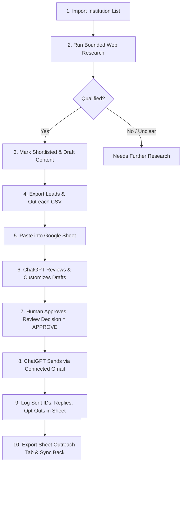

> **Superseded.** This describes the earlier local Next.js/SQLite workflow. The current system is the GitHub Actions + Google Sheets + Apps Script pipeline described in [README.md](README.md). The email spec (3-4 paragraphs, 40-120 words) and sending rules there take precedence.

# OneFolk Institutional Lead-Research & Shortlisting Workflow

This application is an internal institutional lead-research, qualification, and shortlisting engine. It is designed to run entirely on free-tier, local equipment with zero cloud hosting, subscription fees, or paid API requirements.

---

## 1. Architecture Overview & Component Accounting

### What Was Reused
- **Next.js 14 / TypeScript Frontend (`apps/web`)**: Clean, reactive web interface styled with Tailwind CSS and Lucide icons.
- **Node.js Test Runner (`node:test`)**: High-speed, zero-dependency unit and integration test runner.
- **Existing discovery and normalization concepts**: Reused naming normalizers and geographic location parsers.

### What Was Replaced
- **Removed Rust / Redis / PostgreSQL backend dependency**: Incomplete multi-container architecture replaced with a single local runtime using Node.js 24's native `node:sqlite` (`DatabaseSync`). Durable local SQLite storage (`./data/onefolk.db`) ensures zero setup overhead, instant recovery across reboots, and zero database hosting costs.
- **Removed hardcoded scoring & fabricated ratings**: Replaced hardcoded arithmetic (e.g. baseline 30 points, fake reviews, imaginary ROI and revenue loss formulas) with evidence-backed observation. Missing features are reported honestly as `NOT_OBSERVED`, never assumed absent.
- **Replaced naive regex crawler with SSRF-guarded HTTP client**:
  - DNS pre-resolution blocks loopback (`127.0.0.0/8`, `::1`), link-local / cloud metadata (`169.254.169.254`, `fe80::`), and private RFC 1918 subnets (`10.0.0.0/8`, `172.16.0.0/12`, `192.168.0.0/16`).
  - Safe redirect following with SSRF re-validation on every hop.
  - Bounded resource consumption (8-second timeout, 1MB maximum payload, bounded sub-page crawl depth).
- **Separated Campuses from Parent Organizations**: Campuses sharing a parent domain are differentiated by campus identity; they are never collapsed or merged blindly by domain.
- **Strict Contact Provenance**: Extracted emails and phone numbers retain exact source page URLs and timestamps. Regex matches are never labeled verified (`verified = false`).

### What Remains Optional
- **AI API Adapter (e.g. Gemini Free Tier)**: The system is 100% operational with zero AI keys. An optional free-tier LLM adapter can be configured for qualitative synthesis, but rule-based qualification and templated drafting operate autonomously as default fallbacks.
- **Live Google Sheets API Integration**: The safe 5-tab CSV import/export operates safely without OAuth credentials or cloud configuration. If Google Cloud service account credentials are added later, live sync can be enabled non-destructively.

---

## 2. Operational Spreadsheet Schema (5 Tabs)

One Google Spreadsheet serves as the shared operational record between the local research tool and your manual ChatGPT outreach workflow.

### Tab 1: `Leads`
| Field | Description | Ownership |
|---|---|---|
| `Lead ID` | Stable unique ID (`inst_...`) | OneFolk Tool |
| `Source ID` | ID from original imported list | Import Source |
| `Institution Name` | Name of school, college, or university | Research Tool / User |
| `Campus Name` | Campus or branch identity | Research Tool / User |
| `Parent Organization` | Governing trust, district, or foundation | Research Tool / User |
| `Location` / `City` / `State` / `Country` | Geographic identifiers | Research Tool / User |
| `Website URL` | Official website URL | Research Tool / User |
| `Domain` | Normalized domain name | Research Tool |
| `Website State` | `UNKNOWN`, `VERIFIED_PRESENT`, `UNREACHABLE`, `NOT_FOUND` | Research Tool |
| `Research Status` | `UNRESEARCHED`, `RESEARCHED`, `RESEARCH_FAILED` | Research Tool |
| `Qualification Status` | `PENDING_REVIEW`, `QUALIFIED`, `NEEDS_FURTHER_RESEARCH`, `DISQUALIFIED` | Research Tool / User |
| `Shortlisted` | `TRUE` / `FALSE` | Research Tool / User |
| `Qualification Reason` | Transparent explanation of qualification decision | Research Tool |
| `Shortlist Reason` | Primary opportunity hook | Research Tool |
| `Notes / Manual Review` | Human auditor notes & verification reasoning | Human Reviewer |
| `Created At` / `Last Researched At` | Audit timestamps | System |

### Tab 2: `Evidence`
| Field | Description | Ownership |
|---|---|---|
| `Evidence ID` | Unique evidence identifier (`ev_...`) | Research Tool |
| `Lead ID` | Foreign key to `Leads` | Research Tool |
| `Signal Key` | Signal identifier (e.g. `digital_admissions`, `ssl_encryption`) | Research Tool |
| `Signal Label` | Human-readable signal name | Research Tool |
| `Claim` | Factual observation claim | Research Tool |
| `Status` | `DETECTED`, `NOT_OBSERVED`, `UNKNOWN` | Research Tool |
| `Source URL` | Exact webpage where signal was checked | Research Tool |
| `Evidence Snippet` | Snippet or HTTP response status | Research Tool |
| `Confidence` | Observation confidence score (0.0 to 1.0) | Research Tool |
| `Observed At` | Observation timestamp | Research Tool |

### Tab 3: `Outreach` (Operational Boundary)
| Field | Description | Ownership |
|---|---|---|
| `Outreach ID` | Unique outreach identifier (`out_...`) | System |
| `Lead ID` | Foreign key to `Leads` | System |
| `Contact Name` / `Email` / `Role` | Target recipient details | Research Tool / Human |
| `Contact Source URL` | Provenance URL where contact was extracted | Research Tool |
| `Outreach Status` | `NOT_CONTACTED`, `DRAFTED`, `APPROVED_TO_CONTACT`, `SENT`, `REPLIED`, `OPTED_OUT` | Human / ChatGPT |
| `Review Decision` | `PENDING`, `APPROVE`, `REJECT`, `HOLD` | Human Reviewer |
| `Draft Recipient` / `Subject` / `Body` | Personalized email draft content | Research Tool / ChatGPT |
| `Approval Version` | Incremented upon each human approval | System / Human |
| `Approval Timestamp` | Timestamp when reviewer approved message | Human Reviewer |
| `Gmail Message ID` / `Thread ID` | Sent message tracking identifiers | ChatGPT via Gmail |
| `Send Result` | Confirmation or transmission error | ChatGPT via Gmail |
| `Reply Status` / `Reply Snippet` | Response outcome and summary | ChatGPT / Human |
| `Bounce Reason` | Delivery bounce reason if undeliverable | Human / ChatGPT |
| `Opt Out Date` | Date when recipient requested no contact | Human / ChatGPT |

### Tab 4: `Suppression`
| Field | Description | Ownership |
|---|---|---|
| `Suppression ID` | Unique suppression identifier | System |
| `Type` | `DOMAIN`, `EMAIL`, or `INSTITUTION` | System / Human |
| `Value` | Value to suppress (e.g. `school.edu`, `optout@school.edu`) | System / Human |
| `Reason` | Unsubscribe, manual block, or do-not-contact | System / Human |
| `Source` | Provenance source (`google_sheets_sync`, `manual`) | System |
| `Added Date` | Timestamp of suppression | System |

### Tab 5: `Settings`
Configuration constants, schema versions, and operational guide references.

---

## 3. Step-by-Step ChatGPT + Google Sheets + Gmail Workflow



### Step 1: Research and Shortlist in OneFolk
1. Launch OneFolk locally (`npm run dev`) and visit `http://localhost:3000`.
2. Click **Import CSV** and paste or upload your target institution list.
3. Click **Research** on imported institutions. The engine validates the domain, executes an SSRF-safe crawl of the homepage and linked admissions/contact pages, extracts contacts with provenance, and evaluates qualification.
4. Review qualified leads. If necessary, click **Edit** to apply manual corrections (which are permanently recorded in the audit log).

### Step 2: Export to Google Sheets
1. Click **Export Leads CSV** and **Export Outreach CSV**.
2. Open your Google Spreadsheet and import/paste the data into the corresponding `Leads` and `Outreach` tabs.

### Step 3: Review and Draft with ChatGPT
1. Start a conversation with ChatGPT (with connected Google Drive / Google Sheets and Gmail tools enabled).
2. Prompt ChatGPT to inspect the `Leads` and `Evidence` tabs for shortlisted institutions:
   > *"Review the shortlisted institutions in the 'Leads' tab. For each shortlisted institution, inspect the observed evidence in the 'Evidence' tab and refine the personalized draft in the 'Outreach' tab. Focus on specific digital admissions and curriculum portal findings. Do NOT send any emails."*
3. ChatGPT updates `Draft Recipient`, `Draft Subject`, and `Draft Body` in the Google Sheet.

### Step 4: Human Review and Approval (Strict Boundary)
1. You (the human operator) review the email drafts in the Google Sheet.
2. For each approved message, set:
   - `Review Decision`: `APPROVE`
   - `Outreach Status`: `APPROVED_TO_CONTACT`
   - `Approval Timestamp`: Current date & time

> **CRITICAL RULE**: Changes to recipient, subject, or body invalidate any prior approval. Shortlisting a lead does not mean it is approved to contact.

### Step 5: Send via ChatGPT with Connected Gmail
1. In your ChatGPT conversation with connected Gmail, instruct:
   > *"Find all rows in the 'Outreach' tab where Review Decision is 'APPROVE' and Outreach Status is 'APPROVED_TO_CONTACT'. For each approved row, send the exact draft email via Gmail to the Draft Recipient. After sending, write back the Gmail Message ID, Gmail Thread ID, and set Outreach Status to 'SENT'."*
2. ChatGPT sends the emails under your authorized Gmail session and logs the message IDs back into the spreadsheet.

### Step 6: Log Replies, Bounces, and Opt-outs
- When a response is received, log the reply status in the spreadsheet.
- If an institution unsubscribes or requests no further contact, set `Outreach Status` to `OPTED_OUT` and record the `Opt Out Date`.

### Step 7: Sync Back to OneFolk
1. In Google Sheets, export the updated `Outreach` tab as CSV.
2. In the OneFolk application, click **Sync from Sheets** and paste the CSV.
3. The local system:
   - Synchronizes `Outreach Status`, `Gmail Message ID`, and `Review Decision`.
   - **Guarantees**: Local research data is never corrupted or overwritten.
   - Automatically adds any opted-out domains or emails to the permanent **Suppression** table to prevent rediscovery across future imports.

---

## 4. Setup and Quickstart

### Prerequisites
- Node.js 24.x (or higher with native `node:sqlite`)
- npm 10.x

### Installation
```bash
# Clone the repository and switch to the rebuild branch
git clone https://github.com/onefolk/Client-Automation.git
cd Client-Automation
git checkout rebuild

# Install dependencies
npm install
```

### Running Locally
```bash
# Start the local development server (binds to loopback 127.0.0.1:3000 by default)
npm run dev
```
Open your browser to `http://localhost:3000`.

### Running Automated Tests
```bash
# Runs the full unit and integration test suite (36 tests)
npm test
```

### Testing with Synthetic Fixtures
A clearly labeled synthetic test fixture is available at `fixtures/sample_institutions.csv`. You can import this file via the **Import CSV** button on the dashboard to test campus differentiation, no-website qualification, and SSRF loopback blocking without using real leads.

---

## 5. OneFolk 9 AM Morning Outreach Queue (Fully Automated Architecture)

The system automatically prepares an evergreen target of **at least 50 fresh, qualified, personalized leads** with complete email drafts in the Master Google Sheet by **9:00 AM IST** every business day.

### Automated Nightly Schedule
| Time (IST) | Time (UTC) | Workflow / Trigger | Autonomous Actions Taken |
| :--- | :---: | :--- | :--- |
| **10:00 PM** | 16:30 UTC | `morning_queue.yml` | Audits Approval Queue reserve; executes multi-industry discovery & bounded research; drafts personalized 3-paragraph emails via Groq for deficit leads. |
| **8:30 AM** | 03:00 UTC | `morning_queue.yml` | Verifies reserve freshness, checks retro-suppressions, and performs morning top-up if any leads were modified or disqualified. |
| **9:00 AM** | 03:30 UTC | GitHub Summary | Publishes morning queue readiness report with exact counts and direct link to Approval Queue. |
| **1:00 PM** | 07:30 UTC | `send_sync.yml` | Midday sync of Gmail sending activity and quota audit logs with Dashboard tab. |
| **6:00 PM** | 12:30 UTC | `reconcile.yml` | Reconciles inbox bounces, replies, unsubscriptions, and updates permanent suppression lists. |

### Lead Quality & Grounding Guarantees
Every lead presented in the **Approval Queue** has:
1. **Public Contact Provenance**: Exact source webpage URL for the public business email and website observation.
2. **Deterministic Qualification**: Verified domain email, active HTTPS, mobile viewport, and transparent scoring (>= 60).
3. **Factual Grounding**: Strictly 4 paragraphs (Observation, Recommendation, OneFolk Capability, Low-pressure CTA), 70–120 words target, approved portfolio line included verbatim, and two alternative opening lines for review.
4. **Evergreen Reserve Separation**:
   - `Newly discovered today`: Fresh candidates crawled overnight.
   - `Qualified overnight`: Researched and scored >= 60.
   - `Drawn from validated backlog`: Unsent fresh drafts maintained in the queue (< 14 days old).
   - `Ready for approval at 9 AM`: Total actionable queue.
   - `Needs research / Rejected`: Unverifiable contacts or technical failures.
   - `Suppressed or duplicate`: Filtered out automatically.

### Dual-Key Human Approval Protocol
- **Live Gmail Sending Status**: Live sending is active (`IMPLEMENTATION_SENDING_LOCK=false`, `ENABLE_SENDING=YES`) and restricted strictly to business hours (09:00 - 18:00 IST Mon-Fri).
- **Daily Targets**:
  - **Operator Daily Review Goal**: 10 priority leads per morning.
  - **Maximum Daily Pipeline Ceiling**: 50 recipients per Indian Standard Time (IST) calendar day.
- In the **Approval Queue** tab / Web Dashboard:
  - All new records arrive with `status = AWAITING_REVIEW` and `approval = PENDING`.
  - To authorize a lead for sending, set BOTH `status = APPROVED` and `approval = APPROVED` (handled automatically via the Dashboard "Approve" button).
  - Content changes automatically invalidate prior approvals and recalculate fingerprints.
  - Rejected drafts marked `REJECTED` are permanently skipped and never dispatched.

