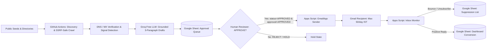

# OneFolk Outreach Engine — Production Cloud System

[](https://github.com/onefolk/Client-Automation/actions/workflows/ci.yml)
[](docs/TEST_RESULTS.md)
[](docs/ARCHITECTURE.md)
[](https://docs.google.com/spreadsheets/d/1U3JxQUcxSyqfZySnHNdLIwExtr3ikfcYlj0a3YY7ATM/edit)
[-red?style=flat)](docs/DEPLOYMENT.md)
[-brightgreen?style=flat)](docs/ARCHITECTURE.md)
[](docs/DEPLOYMENT.md)

---

## 1. Executive Overview
The **OneFolk Outreach Engine** is an autonomous, cloud-hosted, zero-additional-cost (₹0 / $0) B2B prospecting, website research, and email outreach system. It operates entirely in the cloud without requiring any local user computer, privately rented server, or paid API subscription.

### Key Capabilities
- **Multi-Industry Discovery**: Automatically discovers business prospects across Educational Institutions, Events & Conferences, Hospitality & Dining, Professional Services, Creative & Architecture Studios, and Retail/Consumer brands.
- **SSRF-Guarded Research**: Pre-resolves DNS and blocks loopback, private subnets (RFC 1918), and cloud metadata (`169.254.169.254`), preventing server-side network pivoting.
- **Verifiable Factual Observations**: Detects concrete technical opportunities (HTTPS, mobile responsiveness, structured inquiry forms vs. mailto links, portal workflows) without speculating or inventing negative business claims.
- **Grounded AI Email Drafting**: Uses Groq's free-tier LLM (`llama-3.3-70b-versatile`) to produce strict, 3-paragraph cold emails (<70 words) with verbatim authentic OneFolk portfolio proof and two alternative opening lines for review.
- **Master Google Sheet Integration**: Persists all records into a single master spreadsheet across 7 structured tabs (`Dashboard`, `Lead Database`, `Approval Queue`, `Email Activity`, `Suppression List`, `Campaign Runs`, `Settings`), fully preserving historical `Sent Emails`.
- **Dual-Key Human Authorization**: Email sending is **disabled by default**. Sending requires explicit manual approval (`status == APPROVED` AND `approval == APPROVED`).
- **Transactional Gmail Gateway**: Bound Google Apps Script dispatches authorized emails up to **50 recipients per IST day**, monitors inbox replies, auto-suppresses declines/bounces, and prevents duplicate sends.

---

## 2. Master Google Sheet

All operations synchronize to the existing master spreadsheet:  
👉 **[Open OneFolk Master Outreach Sheet](https://docs.google.com/spreadsheets/d/1U3JxQUcxSyqfZySnHNdLIwExtr3ikfcYlj0a3YY7ATM/edit)**

The spreadsheet contains 7 logical tabs:
1. **`Dashboard`**: Live operational metrics, pipeline funnel, conversion rates, run duration, and actual spending (**₹0.00**).
2. **`Lead Database`**: Master prospect inventory with qualification scores and technical observations.
3. **`Approval Queue`**: Actionable human review queue for approving or rejecting outbound drafts.
4. **`Email Activity`**: Full audit log of all sent messages, timestamps, and thread tracking.
5. **`Suppression List`**: Permanent blacklist of bounced, declined, and unsubscribed domains and emails.
6. **`Campaign Runs`**: Historical execution ledger tracking duration, quota usage, and lead yields.
7. **`Settings`**: System constants, caps, and campaign preset definitions.

---

## 3. Cloud Architecture & Workflows



### GitHub Actions Workflows (`.github/workflows/`)
- [ci.yml](file:///.github/workflows/ci.yml): Automated test runner, syntax compiler, and quality gate.
- [discover.yml](file:///.github/workflows/discover.yml): Scheduled weekdays at 03:30 UTC (~09:00 IST) for multi-industry discovery and website research.
- [draft.yml](file:///.github/workflows/draft.yml): Grounded Groq AI drafting populating the `Approval Queue`.
- [send_sync.yml](file:///.github/workflows/send_sync.yml): Scheduled synchronization between Google Sheets, Apps Script, and the Dashboard.
- [reconcile.yml](file:///.github/workflows/reconcile.yml): Bounce and reply reconciliation updating the `Suppression List`.

---

## 4. Documentation Index

Detailed architectural and operational documentation is available in `docs/`:
- **[docs/AUDIT.md](docs/AUDIT.md)**: Technical audit comparing the legacy codebase vs. the starter package, identified gaps, and implementation checklist.
- **[docs/ARCHITECTURE.md](docs/ARCHITECTURE.md)**: Comprehensive cloud topology, component accounting, state machine, and tool evaluations (`google-maps-scraper`, `crawl4ai`).
- **[docs/DEPLOYMENT.md](docs/DEPLOYMENT.md)**: Step-by-step deployment guide for GitHub Actions secrets, Google Cloud Service Account, Google Apps Script, and Groq API.
- **[docs/SECURITY.md](docs/SECURITY.md)**: Security specification covering SSRF prevention, secrets isolation, least privilege, anti-spam safeguards, and factual grounding.
- **[docs/TEST_RESULTS.md](docs/TEST_RESULTS.md)**: Automated test execution report detailing 100% pass rate across 33 test suites.

---

## 5. Local Quickstart & Verification

### Running Automated Tests
```bash
# Install dependencies
pip install -r requirements.txt

# Run full test suite (33 unit & integration tests)
pytest -v
```

### Running an End-to-End Dry Run
To test the complete discovery, crawling, signal extraction, and drafting pipeline without external mutations:
```bash
python -m src.cli dry-run --target 5
```

---

## 6. Safety & Sending Kill-Switch Notice

> [!CAUTION]
> **Live email sending is DISABLED BY DEFAULT.**  
> In `apps-script/Code.gs`, sending will strictly refuse to execute unless the Script Property `ENABLE_SENDING` is set to `YES`.  
> To trigger an immediate emergency halt, run `emergencyStop()` inside Apps Script or set `ENABLE_SENDING` to `NO`.
