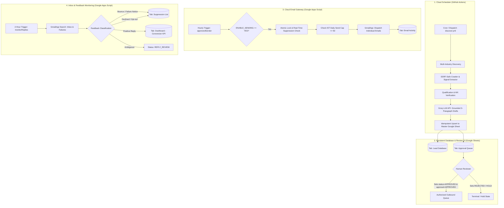

> **Partly superseded.** The email format is now 3-4 short paragraphs, 40-120 body words (target 50-90), with an optional proof line. Discovery sources and conversion tracking are listed in [README.md](../README.md).

# OneFolk Outreach Engine — Cloud Architecture & Specification

## 1. Architectural Philosophy

The OneFolk Outreach Engine is designed as an autonomous, cloud-hosted, zero-additional-cost (₹0 / $0) B2B prospecting and relationship management system. It requires **no local computer, desktop workstation, or privately rented server** once configured.



---

## 2. Component Topology

| Component | Technology | Hosting / Runtime | Role | Cost |
| :--- | :--- | :--- | :--- | :--- |
| **Execution Scheduler** | GitHub Actions | Ubuntu Hosted Runners | Runs scheduled Python discovery, research, AI drafting, and CI quality gates | ₹0 (within 2,000 min/mo free allowance) |
| **Core Prospecting Engine** | Python 3.11+ | GitHub Actions Runner | Directory parsing, SSRF-safe crawling, contact extraction, and Groq integration | ₹0 (Open Source) |
| **Persistent Storage** | Google Sheets API | Google Cloud Platform | Serves as 7-tab relational data store, approval portal, and executive dashboard | ₹0 (Standard Free Tier) |
| **Email Gateway** | Google Apps Script | Google V8 Cloud Runtime | Bounded dispatch engine communicating directly with GmailApp | ₹0 (Included with Google Account) |
| **Outreach Mailbox** | Gmail | Google Infrastructure | Authorized sender identity (`Team OneFolk <contact.onefolk@gmail.com>`) | ₹0 (Existing Account) |
| **AI Inference Engine** | Groq API | Groq LPU Cloud Platform | Generates grounded 3-paragraph cold drafts using `llama-3.3-70b-versatile` | ₹0 (Groq Free Tier) |

---

## 3. Data Flow & Lifecycle State Machine

### 3.1 Lead Qualification Lifecycle
```
[Unresearched Candidate]
       │
       ▼
 [Safe Fetch & Signal Extraction]
       │
       ├─► [No Valid Domain Email or DNS/MX Fails] ──► DISQUALIFIED
       ├─► [Incomplete / Ambiguous Technical Clues]  ──► NEEDS_RESEARCH
       │
       ▼
[Score >= 60 & Valid Contact] ──► QUALIFIED
       │
       ▼
[Groq AI Drafting Engine] ──► Generated 4 Paragraphs (70–120 words target) + 2 Alt Openings
       │
       ▼
[Approval Queue Tab] ──► AWAITING_REVIEW
```

### 3.2 Human Authorization & Sending State Machine
The system adheres to an uncompromising **dual-key human authorization protocol**:
1. Automatic drafts enter `Approval Queue` with `status: AWAITING_REVIEW` and `approval: PENDING`.
2. A human team member inspects the draft, evidence URL, and observation.
3. The human marks `status: APPROVED` **AND** `approval: APPROVED`.
4. Only when both fields equal `APPROVED` does the row become eligible for dispatch.
5. Right before dispatch, Apps Script verifies:
   - Recipient email syntax.
   - Immediate cross-check against `Suppression List` and historical `Sent Emails`.
   - Body contains exactly 4 paragraphs and 50–150 words (70–120 words target).
   - Daily IST recipient count is < 50.
6. The row transitions to `SENDING` (atomic reservation state to prevent duplicate sends upon provider timeout).
7. Upon confirmed dispatch, the row transitions to `SENT`, a log is written to `Email Activity`, and the IST send counter increments.
8. If an unexpected error occurs, the row transitions to `SEND_REVIEW` with the error trace, halting further automated retries.

### 3.3 Reply & Bounce Feedback State Machine
```
[Gmail Inbox / Delivery Status Notifications]
       │
       ├─► Delivery Status Notification (Failure) ──► Mark BOUNCED ──► Add to Suppression List
       ├─► Negative keywords (unsubscribe, stop)  ──► Mark DECLINED ──► Add to Suppression List
       ├─► Positive keywords (meeting, call)      ──► Mark POSITIVE_REPLY ──► Dashboard Alert
       └─► Ambiguous text                          ──► Mark REPLY_REVIEW ──► Manual Triage
```

---

## 4. Master Google Sheet Schema (7 Operational Tabs)

The existing master Google Sheet (`1U3JxQUcxSyqfZySnHNdLIwExtr3ikfcYlj0a3YY7ATM`) is structured into 7 logical tabs while preserving historical `Sent Emails` records:

### Tab 1: `Dashboard`
Live KPI tracker updated automatically at the conclusion of every execution:
- **Pipeline Volume**: Prospects Discovered, Prospects Scraped, Qualified Leads, Needs Research.
- **Outreach Volume**: Emails Drafted, Emails Approved, Emails Sent.
- **Conversion Metrics**: Bounces, Positive Replies, Negative Replies, Conversion Rate %.
- **Execution & Cost**: Run Duration, API Quota Usage, Actual Spending (**strictly ₹0.00**).

### Tab 2: `Lead Database`
Master prospect inventory (`lead_id, business, industry, city, website, source_url, public_email, email_source_url, qualification_score, qualification_status, observation, observation_url, opportunity, proof_project, discovered_at, updated_at`).

### Tab 3: `Approval Queue`
Human review interface (`lead_id, business, industry, website, public_email, subject, email_body, alt_opening_1, alt_opening_2, observation, observation_url, proof_project, proof_line, qualification_score, status, approval, reviewer_notes, created_at, updated_at`).

### Tab 4: `Email Activity`
Detailed audit trail of all outbound attempts (`activity_id, lead_id, business, recipient_email, subject, status, sent_at, gmail_message_id, gmail_thread_id, reply_status, reply_snippet, bounce_reason, notes, updated_at`).

### Tab 5: `Suppression List`
Permanent suppression records (`suppression_id, type, value, reason, source, added_at`).

### Tab 6: `Campaign Runs`
Execution history per workflow (`run_id, campaign_name, start_time, end_time, duration_seconds, prospects_discovered, prospects_scraped, qualified_leads, needs_research, emails_drafted, ai_calls_used, http_fetches_used, cost_incurred, status`).

### Tab 7: `Settings`
Operational constants, version tags, and campaign metadata.

---

## 5. Free-Tier Budget & Runner Quota Accounting

The entire system operates strictly within permanently free allowances:
1. **GitHub Actions**: 2,000 runner minutes/month for private repositories. Each discovery and drafting run completes in 2-4 minutes, allowing ~500 to 1,000 runs per month without cost.
2. **Google Sheets API**: 300 read/write requests per minute via service account, comfortably supporting batch upserts.
3. **Gmail Sending Quota**: Apps Script consumer limit is 100/day; our hard application cap is set to **50 recipients per IST day** to maintain optimal sender reputation.
4. **Groq Free Tier**: Generous free tier limits (up to 30 requests/minute and 6,000 tokens/minute on `llama-3.3-70b-versatile`). Our client enforces an internal budget of 120 calls per run with exponential backoff.
5. **No Paid Dependencies**: Zero dependency on paid scrapers, proxy rotation pools, captcha bypassers, or paid LLMs (OpenAI, Anthropic, Gemini API).

---

## 6. Evaluation of Optional Open-Source Tools

### 6.1 `gosom/google-maps-scraper`
- **Evaluation**: This tool uses high-concurrency headless browsers to scrape Google Maps local business listings.
- **Architectural Decision**: **REJECTED / EXCLUDED**.
- **Rationale**:
  1. Violates Google Maps Terms of Service regarding automated extraction.
  2. Requires rotating residential proxy services to evade IP blocks, which introduces ongoing subscription fees, violating the ₹0 budget requirement.
  3. Hosted GitHub Actions runners have static, shared IP blocks that are immediately flagged and throttled by Google anti-bot systems.
  4. Public directories and institutional registries provide authorized, higher-fidelity business and contact information.

### 6.2 `unclecode/crawl4ai`
- **Evaluation**: An asynchronous, Playwright-based web crawler tailored for AI extraction.
- **Architectural Decision**: **REJECTED / EXCLUDED for core runner**.
- **Rationale**:
  1. Requires full installation of Playwright, Chromium, and system browser dependencies (400MB+ download on every runner startup).
  2. High memory footprint (1.5GB+ per browser instance) risks Out-Of-Memory (OOM) crashes on standard 7GB hosted runners.
  3. Our custom `SafeFetcher` built on `requests` and `BeautifulSoup` executes with zero browser overhead, uses <50MB RAM, starts instantaneously, and incorporates our custom DNS pre-resolution SSRF protection.
