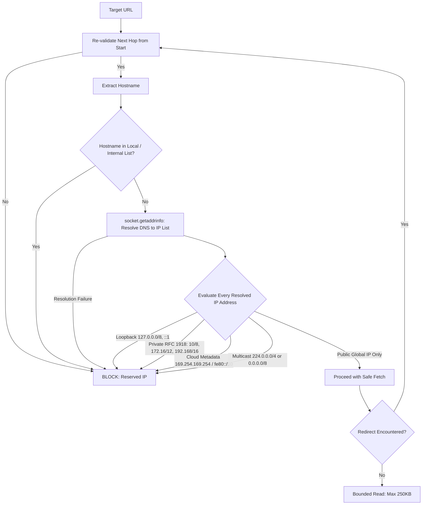

# OneFolk Outreach Engine — Security Architecture & Threat Model

**Version:** 1.0  
**Classification:** Internal Engineering Specification  
**Scope:** GitHub Actions Runners, Network Crawling, Groq LLM Integration, Google Sheets Database, and Gmail Outbound Gateway.

---

## 1. Threat Model & Security Posture

The OneFolk Outreach Engine executes automated web crawling, contact extraction, and scheduled outbound email communications. The security model addresses four primary threat categories:
1. **Server-Side Request Forgery (SSRF) & Internal Network Pivoting**: Preventing external web targets from tricking the cloud runner into scanning internal services, Docker networks, or cloud metadata APIs (e.g. `169.254.169.254`).
2. **Credential Compromise & Privilege Escalation**: Ensuring API tokens, Google service account keys, and Gmail permissions cannot leak into git history, log streams, or third-party platforms.
3. **Email Deliverability & Spam Abuse**: Enforcing strict human approval, rate limits, and suppression to prevent unauthorized, bulk, or deceptive email transmission.
4. **Factual Fabrication & Hallucination**: Preventing LLM outputs from generating fictitious client achievements, unverified technical defects, or deceptive claims.

---

## 2. Server-Side Request Forgery (SSRF) Defense

### 2.1 The Vulnerability in Standard Python Scrapers
Naive scrapers rely on simple string or regex checks (e.g. `url.startswith("http")`), or use `ipaddress.ip_address(hostname)` inside a `try/except ValueError` block. When provided with a public domain name (e.g. `attacker.com`), `ipaddress.ip_address()` raises `ValueError`, causing naive scrapers to classify the domain as "safe". If `attacker.com` resolves to `127.0.0.1` or `169.254.169.254` (DNS rebinding or private A records), the scraper connects directly to internal infrastructure or cloud metadata.

### 2.2 OneFolk SSRF Mitigation Architecture
Our `src/network.py` module enforces **pre-request DNS socket resolution** and exhaustive IP subnet inspection before any HTTP connection is attempted:



### 2.3 Additional Crawling Safeguards
- **Bounded Request Timeout**: 10-second hard socket timeout prevents slowloris hangs.
- **Bounded Response Payloads**: Responses are read up to a maximum of 250 KB via `response.raw.read(250000)`, preventing memory exhaustion and decompression bombs.
- **Manual Redirect Validation**: Automatic HTTP redirects are disabled; redirects are parsed manually and re-evaluated through `is_safe_url` at each hop (maximum 3 hops).
- **Anti-Bot & Terms of Service Compliance**:
  - The crawler identifies itself transparently with an informative User-Agent (`OneFolk research bot (public pages; contact: contact.onefolk@gmail.com)`).
  - No CAPTCHA bypassing, proxy rotation, or anti-bot circumvention mechanisms are used.

---

## 3. Secrets Management & Least Privilege

### 3.1 GitHub Actions Permissions
All workflows explicitly restrict the runner's default GitHub token to read-only access:
```yaml
permissions:
  contents: read
```

### 3.2 Google Cloud Service Account Isolation
- The service account is granted zero global roles in the Google Cloud project.
- It is shared explicitly with **only the designated master Google Sheet** (`1U3JxQUcxSyqfZySnHNdLIwExtr3ikfcYlj0a3YY7ATM`) as an Editor.
- The service account is **never** granted Google Workspace Domain-Wide Delegation, Google Drive permissions, or Gmail permissions.

### 3.3 Google Apps Script OAuth Token Lifecycle
- Apps Script operates bound directly to the user's Google Sheet and Gmail session.
- Authentication tokens are generated, rotated, and invalidated natively by Google's OAuth infrastructure.
- No long-lived refresh tokens or Gmail credentials are ever committed, stored on disk, or transferred to GitHub.

---

## 4. Email Outreach Safety & Anti-Spam Controls

### 4.1 Strict Dual-Key Human Authorization
Sending is **disabled by default** (`ENABLE_SENDING != 'YES'`). Even when enabled, no automated email can be sent without explicit, manual human authorization:
- A human operator must review the draft and evidence in the `Approval Queue` tab.
- The operator must explicitly set **both** columns:
  - `status` = `APPROVED`
  - `approval` = `APPROVED`
- Any draft marked `PENDING`, `AWAITING_REVIEW`, `REJECTED`, or `HOLD` is permanently bypassed by the sender.

### 4.2 Application-Level Daily Cap
- Outbound sends are subject to a **hard cap of 50 recipients per Indian Standard Time (IST) calendar day**.
- Daily send counts are tracked atomically in Apps Script Properties (`SENT_YYYY-MM-DD`).
- The sender takes the minimum of `(50 - usedToday)` and Google's remaining daily quota (`MailApp.getRemainingDailyQuota()`).

### 4.3 Atomic Reservation State (`SENDING`)
To prevent duplicate sends during transient network latency or Google API timeouts:
1. The script acquires an atomic execution lock via `LockService.getScriptLock()`.
2. The row status is updated to `SENDING` and committed via `SpreadsheetApp.flush()` *before* invoking `GmailApp.sendEmail()`.
3. If transmission fails, the row transitions to `SEND_REVIEW` with an error message, preventing automated re-dispatch.

### 4.4 Real-Time Suppression & Unsubscribe Handling
- Suppression is checked three times:
  1. During discovery candidate filtering.
  2. During contact email investigation.
  3. Immediately before dispatch inside Apps Script.
- Any email expressing disinterest, unsubscribe, or opt-out requests is immediately updated to `DECLINED` and appended to the `Suppression List` tab.
- All subsequent outreach to that recipient or apex domain is permanently blocked.

---

## 5. Factual Grounding & Prompt Safety

### 5.1 Deterministic Grounding Checks
The Groq AI LLM is strictly decoupled from qualification and factual verification. The system never relies on the model to self-certify its claims:
1. **Verbatim Portfolio Proof**: Every drafted message must include the exact approved proof line from `config/portfolio.json`. If missing, it is injected deterministically.
2. **Word Count Ceiling**: The message body must be strictly under 70 words total.
3. **Three-Paragraph Constraint**: The message body must consist of exactly three short paragraphs.
4. **Verified Evidence Citation**: The cited `observation_url` must match an actual page fetched during research.
5. **No Negative Fabrications**: Observations are strictly technical (e.g. missing mobile viewport, static mailto instead of online form); the system never infers or claims that the business is losing revenue, failing, or suffering customer attrition.
